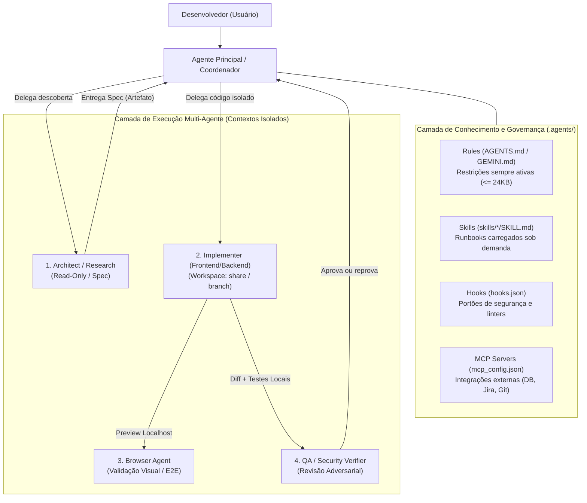

# Guia Completo: Melhores Práticas e Arquitetura de Agentes no Google Antigravity

Este documento apresenta uma análise completa de engenharia de software assistida por IA utilizando o **Google Antigravity (AGY)** — abrangendo a arquitetura de contexto, o fluxo de desenvolvimento orientado a especificações (*Spec-Driven Development*), o catálogo completo de agentes necessários (com regras estritas do que **fazer** e **não fazer**) e o passo a passo técnico para criá-los.

---

## 1. Visão Geral da Arquitetura: A Tríade do Antigravity

O erro mais comum ao utilizar sistemas agênticos é tratar um único chat como um "faz-tudo" monolítico. À medida que a conversa cresce, ocorre a **poluição da janela de contexto** (*context collapse*): logs de testes, buscas em centenas de arquivos e discussões de arquitetura se misturam, degradando a precisão do modelo.

No Antigravity, as melhores práticas se baseiam em separar **Restrições**, **Procedimentos** e **Execução Isolada**:



### Os 5 Pilares de Customização

| Tipo | Arquivo / Pasta | Escopo de Carregamento | Quando Usar |
| :--- | :--- | :--- | :--- |
| **Rules (Regras)** | `AGENTS.md`, `GEMINI.md`, `.agents/rules/*.md` | Hierárquico / Sempre ativo no diretório | Definir padrões de código, restrições de API, comandos proibidos e convenções curtas do repositório. |
| **Skills (Habilidades)** | `.agents/skills/<nome>/SKILL.md` | Sob demanda (*Progressive Disclosure*) | Ensinar procedimentos passo a passo (como rodar migrações, criar componentes, fazer deploy) sem gastar tokens quando não estão em uso. |
| **Agents (Subagentes)** | `.agents/agents/<nome>.md` | Contexto isolado por tarefa | Criar especialistas com permissões restritas (ex.: um revisor somente-leitura ou um especialista em banco de dados). |
| **Hooks (Gatilhos)** | `.agents/hooks.json` | Eventos do ciclo de vida (`PreToolUse`, `PostToolUse`, `Stop`) | Bloquear comandos destrutivos antes de rodarem ou executar formatadores/linters automaticamente após edições. |
| **Plugins (Pacotes)** | `~/.gemini/config/plugins/<nome>/plugin.json` | Bundle compartilhável (Global ou Projeto) | Empacotar `skills/`, `agents/`, `rules/`, `hooks.json` e `mcp_config.json` em uma única unidade ativável/desativável. |

> [!IMPORTANT]
> **Orçamento de Contexto e Divulgação Progressiva (*Progressive Disclosure*):**
> Cada arquivo de regra (`AGENTS.md` / `GEMINI.md`) tem limite estrito de **24 KB**, e o orçamento agregado de regras sempre ativas é de **20.000 tokens**. Nunca coloque tutoriais longos ou documentação extensa dentro do `AGENTS.md` — coloque apenas regras curtas e mova os procedimentos detalhados para **Skills** (`SKILL.md` + pasta `references/`), pois o Antigravity injeta apenas o `name` e `description` da Skill no prompt inicial e só lê o arquivo completo quando necessário.

---

## 2. Melhores Práticas de Fluxo de Trabalho (Workflow)

### 2.1. Desenvolvimento Orientado a Especificação (*Spec-Driven Development - SDD*)
Nunca peça para um agente implementar uma funcionalidade complexa diretamente do zero sem antes mapear o impacto. Siga o ciclo em 4 fases:

1. **Fase 1 — Descoberta e Especificação (Read-Only):** Use o subagente `research` ou um agente `architect` (ou os comandos `/plan` e `/grill-me`) para mapear o repositório e gerar um artefato Markdown de especificação contendo: arquivos exatos a modificar, contratos de dados, casos de borda e plano de verificação.
2. **Fase 2 — Execução com Isolamento de Workspace:** Quando dois ou mais agentes editam código simultaneamente, **nunca** use o mesmo diretório de trabalho (`workspace: "inherit"`). Use `workspace: "share"` (cria uma cópia de trabalho compartilhando o repositório Git subjacente, similar a um `git worktree`) ou `workspace: "branch"` (clone isolado).
3. **Fase 3 — Handoff Baseado em Artefatos:** Subagentes não devem despejar milhares de linhas de logs na conversa principal. Eles devem salvar relatórios detalhados em arquivos/artefatos e retornar ao agente coordenador apenas um resumo executivo (TL;DR) com links para os arquivos modificados.
4. **Fase 4 — Verificação Adversarial Independente:** O agente que escreveu o código tem viés de confirmação. Sempre acione um subagente **Verificador/QA** separado (em uma janela de contexto limpa) cuja única missão é encontrar falhas no diff, rodar os testes e testar casos de borda.

### 2.2. Qual Modo de Orquestração Escolher?

O Antigravity oferece 3 mecanismos nativos para coordenar múltiplos agentes:

| Mecanismo | Ferramenta / Comando | Melhor Para | Como Funciona |
| :--- | :--- | :--- | :--- |
| **Subagentes Hierárquicos** | `invoke_subagent` / `define_subagent` | Tarefas do dia a dia (1 a 4 subtarefas delegadas) | O agente principal chama um especialista em background e recebe o resultado. Suporta *auto-wake* via `send_message`. |
| **Dynamic Workflows** | `run_workflow` (Script Python) | Pipelines estruturados e *fan-out* em lote (ex.: revisar 30 arquivos em paralelo) | Um script Python assíncrono coordena agentes com `agent()`, `parallel()`, `pipeline()` e valida saídas via JSON Schema (`finish`). |
| **Swarm (Enxame)** | `swarm` / `/teamwork` | Projetos grandes com múltiplos módulos independentes e revisão cruzada contínua | Vários agentes colaboram através de um quadro de mensagens compartilhado (`main` e canais `#area`), com `narrator` e `monitor` dedicados. |

---

## 3. Quais Agentes São Necessários? (OQue Fazer e O Que Não Fazer)

Uma arquitetura enxuta e de alta performance no Antigravity combina os **Agentes Nativos (Built-in)** da plataforma com **5 Agentes Customizados Essenciais**.

> [!TIP]
> **Regra de Ouro:** Não crie 20 agentes micro-especializados que se sobrepõem. Mantenha a hierarquia rasa (no máximo 2 a 3 níveis: *Coordenador -> Especialista -> Verificador*) e garanta que dois agentes **jamais** editem o mesmo arquivo ao mesmo tempo.

---

### Parte A: Agentes Nativos do Antigravity (Já Incluídos)

#### 1. `Coordinator / Main Agent` (Agente Principal da Conversa)
* **Papel:** Líder técnico, interface direta com o usuário e orquestrador dos subagentes/swarm.
* **O que DEVE fazer (Do's):**
  * Entender a intenção do usuário, fazer perguntas de esclarecimento quando houver ambiguidade (`ask_question`) e quebrar problemas grandes em partes independentes.
  * Delegar pesquisas extensas ao `research`, interações web visuais ao `browser` e tarefas paralelas a subagentes ou `swarm`.
  * Ler e julgar os resumos/diffs que voltam dos subagentes e manter seus próprios turnos curtos e responsivos.
* **O que NÃO DEVE fazer (Don'ts):**
  * **Não** executar dezenas de buscas exploratórias pesadas na thread principal (polui a memória da conversa).
  * **Não** escrever código quando estiver atuando como Coordenador de um `swarm` (um coordenador codificando deixa o enxame parado esperando decisões).
  * **Não** fazer *polling* (loops de espera ou `sleep`) aguardando subagentes ou tarefas em background — o Antigravity acorda o agente reativamente quando a tarefa termina.

#### 2. `research` (Subagente Nativos de Pesquisa)
* **Papel:** Explorador de código e documentação em ambiente **somente-leitura** (*read-only sandbox* sem acesso de escrita).
* **O que DEVE fazer (Do's):**
  * Mapear arquiteturas desconhecidas, rastrear dependências, encontrar onde funções/tipos estão definidos e ler grandes volumes de arquivos.
  * Retornar um relatório estruturado com caminhos absolutos e números de linha exatos (`[arquivo.ts](file:///caminho/arquivo.ts#L10-L25)`).
* **O que NÃO DEVE fazer (Don'ts):**
  * **Não** tentar editar arquivos, rodar builds ou instalar pacotes (não possui ferramentas de escrita).
  * **Não** ser acionado para buscas triviais de 1 arquivo que o agente principal pode ler diretamente.

#### 3. `browser` (Subagente Nativo de Automação Web e UI)
* **Papel:** Operador de navegador integrado (Webview) para testar interfaces em tempo real (`localhost`), fluxos de usuário E2E e aplicações web renderizadas no cliente.
* **O que DEVE fazer (Do's):**
  * Navegar na aplicação rodando localmente ou na web, clicar em botões, preencher formulários, inspecionar o estado visual da UI e capturar screenshots de evidência.
  * Pausar e devolver o controle ao usuário quando encontrar telas de login sensíveis, pagamentos (`PAYMENT_REQUIRED`) ou CAPTCHAs.
  * Ler arquivos de referência visual (mockups) previamente copiados para `browser_sandbox/references/` e fazer uploads a partir de `browser_sandbox/uploads/`.
* **O que NÃO DEVE fazer (Don'ts):**
  * **Não** tentar resolver ou burlar CAPTCHAs, desafios anti-bot ou restrições de domínio bloqueado.
  * **Não** ser substituído por `curl` ou scripts Python no terminal quando o objetivo do usuário é verificar ou interagir visualmente com uma página web.

---

### Parte B: Os 5 Agentes Customizados Essenciais para Desenvolvimento

Abaixo está a especificação completa dos agentes que você deve criar no seu projeto (`.agents/agents/`) ou plugin global:

#### 1. `architect` (Arquiteto de Software & Autor de Especificações)
* **Quando acionar:** Antes de qualquer nova feature, refatoração estrutural ou mudança de banco de dados/API.
* **Ferramentas:** Apenas leitura e pesquisa (`read_file`, `search_web`). **Sem permissão de escrita em código ou execução de terminal.**
* **Workspace:** `inherit` (apenas lê).
* **O que DEVE fazer (Do's):**
  * Analisar os padrões existentes no repositório para manter 100% de consistência arquitetural.
  * Identificar exatamente quais arquivos serão criados ou modificados e definir interfaces, tipos, schemas e contratos de API.
  * Dividir o trabalho em fatias independentes (sem colisão de arquivos) prontas para serem entregues aos agentes implementadores.
  * Definir critérios claros de aceitação e casos de teste obrigatórios.
* **O que NÃO DEVE fazer (Don'ts):**
  * **Não** escrever o código final de produção nem editar arquivos do projeto.
  * **Não** propor novas bibliotecas ou frameworks se o projeto já possui uma solução padrão instalada.
  * **Não** produzir especificações vagas (ex.: "melhorar a performance da API" sem apontar a query, o arquivo e a métrica).

#### 2. `implementer` (Engenheiro de Implementação — Backend / Frontend)
*(Nota: Em projetos grandes, você pode dividir em `backend-engineer` e `frontend-engineer` seguindo o mesmo molde).*
* **Quando acionar:** Após a aprovação da especificação (Spec) ou para correções de bugs bem delimitadas.
* **Ferramentas:** Completo para código (`read_file`, `edit_file`, `write_file`, `run_command`, `manage_task`).
* **Workspace:** `share` (ou `branch`) quando houver mais de um implementador rodando em paralelo; `inherit` se for único.
* **O que DEVE fazer (Do's):**
  * Seguir estritamente o escopo de arquivos atribuído no *brief* (ex.: *"Você é dono de `src/auth/`"*).
  * Escrever código limpo, tipado e aderente às regras do `AGENTS.md` e às `skills/` do projeto.
  * Criar ou atualizar testes unitários correspondentes à mudança e executá-los localmente via `run_command` antes de concluir.
  * Commitar suas mudanças no seu workspace isolado (`share`/`branch`) quando trabalhar em paralelo e reportar o resumo do diff + saída dos testes.
* **O que NÃO DEVE fazer (Don'ts):**
  * **Não** tocar em arquivos fora do seu escopo atribuído (evita conflitos de merge com outros agentes).
  * **Não** alterar ou apagar testes existentes apenas para "fazer o build passar" sem autorização explícita.
  * **Não** instalar novas dependências pesadas nem fazer `git push` para o repositório remoto sem solicitação explícita do usuário.
  * **Não** assumir contexto implícito — se encontrar um bloqueio na interface com outro módulo, deve reportar ao Coordenador.

#### 3. `qa-verifier` (Engenheiro de QA & Verificador Adversarial)
* **Quando acionar:** Sempre que um ou mais agentes `implementer` finalizarem suas tarefas (proporção ideal em Swarm: 1 `qa-verifier` para cada 2 a 4 implementadores).
* **Ferramentas:** Leitura e execução de testes (`read_file`, `run_command`, `manage_task`). **Sem `edit_file` ou `write_file` no código-fonte.**
* **Workspace:** `inherit` (ou inspecionando a branch do autor).
* **O que DEVE fazer (Do's):**
  * Ler o `git diff` completo das alterações feitas pelo implementador.
  * Executar a suíte de testes automatizados, linter e typecheck (`npm test`, `pytest`, `cargo test`, `tsc --noEmit`, etc.).
  * Pensar de forma adversarial: procurar condições de corrida, entradas nulas/vazias, erros de tratamento de exceção e regressões.
  * Emitir um veredito objetivo (`APROVADO` ou `REPROVADO`) listando exatamente o arquivo, a linha e como reproduzir o erro para que o autor corrija.
* **O que NÃO DEVE fazer (Don'ts):**
  * **Não** consertar o código por conta própria! **Um verificador que edita código coloca dois agentes no mesmo arquivo e causa colisão.** O verificador aponta o erro; o autor original corrige.
  * **Não** aprovar código sem ter executado de fato o comando de teste/build e verificado o código de saída (`exit code 0`).

#### 4. `security-auditor` (Auditor de Segurança e Conformidade)
* **Quando acionar:** Em mudanças envolvendo autenticação, autorização, pagamentos, manipulação de dados sensíveis, queries SQL, uploads de arquivos ou exposição de endpoints.
* **Ferramentas:** Somente leitura e execução de scanners (`read_file`, `run_command`, `search_web`). **Sem ferramentas de edição (`edit_file`, `write_file`).**
* **Workspace:** `inherit`.
* **O que DEVE fazer (Do's):**
  * Auditar o código contra vulnerabilidades clássicas (OWASP Top 10: SQL/Command Injection, XSS, SSRF, IDOR, Path Traversal).
  * Verificar vazamento de segredos, tokens, chaves de API hardcoded ou logs expondo PII (dados pessoais).
  * Auditar permissões de novas dependências adicionadas no `package.json`, `requirements.txt`, `go.mod`, etc.
  * Classificar achados por severidade (`Crítica`, `Alta`, `Média`, `Baixa`) com recomendação exata de remediação.
* **O que NÃO DEVE fazer (Don'ts):**
  * **Não** modificar arquivos de código ou configurações de segurança diretamente.
  * **Não** gerar alertas falsos genéricos ("considere usar HTTPS") sem apontar a linha real do código vulnerável.

#### 5. `devops-git` (Guardiao de Integração, Git & CI/CD)
* **Quando acionar:** Na etapa final após aprovação do `qa-verifier` e `security-auditor`, para consolidar branches/worktrees, resolver integrações, atualizar changelogs e preparar commits/PRs.
* **Ferramentas:** `read_file`, `edit_file`, `write_file`, `run_command`, `manage_task`.
* **Workspace:** `inherit` (opera no workspace principal para integrar o trabalho dos demais).
* **O que DEVE fazer (Do's):**
  * Fazer merge ou cherry-pick limpo das branches/worktrees (`workspace: "share"` ou `"branch"`) dos agentes implementadores após a aprovação do QA.
  * Rodar o build/teste de integração final no workspace consolidado antes de encerrar os trabalhadores temporários.
  * Organizar commits atômicos seguindo o padrão do projeto (ex.: *Conventional Commits*: `feat:`, `fix:`, `refactor:`).
* **O que NÃO DEVE fazer (Don'ts):**
  * **Não** matar (`kill`) um trabalhador de `share`/`branch` antes de salvar/integrar seus commits no workspace principal (pois `kill` deleta o workspace temporário do trabalhador).
  * **Não** executar comandos Git destrutivos (`git push --force`, `git reset --hard`, `git clean -fd`) sem confirmação explícita do usuário.

---

### Matriz Resumo de Responsabilidades e Permissões

| Agente | Edita Código? | Roda Terminal? | Workspace Recomendado | Missão Principal | Proibição Crítica (Nunca Fazer) |
| :--- | :---: | :---: | :---: | :--- | :--- |
| **`Coordinator`** | Evitar | Leitura rápida | `inherit` | Planejar, orquestrar e conversar com o usuário | Fazer trabalho pesado sozinho ou fazer polling em loop |
| **`architect`** | ❌ Não | ❌ Não | `inherit` | Analisar codebase e escrever a Spec técnica | Escrever código de implementação ou propor specs vagas |
| **`implementer`** | ✅ Sim | ✅ Sim | `share` / `branch` | Implementar a Spec e criar testes unitários | Editar arquivos fora do seu escopo ou apagar testes |
| **`qa-verifier`** | ❌ Não | ✅ Sim | `inherit` | Rodar testes, ler diff e caçar bugs | Editar o código para consertar bugs (causa colisão!) |
| **`security-auditor`**| ❌ Não | ✅ Sim (Scanners)| `inherit` | Auditar OWASP, segredos, autenticação e deps | Modificar código diretamente ou emitir alertas genéricos |
| **`devops-git`** | ✅ Config/CI| ✅ Sim (Git/Build)| `inherit` | Integrar branches, validar build final e commitar| Matar workspaces antes do merge ou dar `push --force` |

---

## 4. Como Criar os Agentes (Passo a Passo Prático)

Existem **4 formas** de criar e instanciar agentes no Antigravity, dependendo se você quer que eles sejam permanentes no repositório, globais na sua máquina, criados sob demanda na conversa ou orquestrados via código.

### Método 1: Agentes Persistentes em Markdown (Recomendado para Projetos e Equipes)

Você pode definir agentes como arquivos Markdown (`.md`) com cabeçalho YAML Frontmatter em dois lugares:
1. **No Projeto (compartilhado via Git):** `.agents/agents/<nome-do-agente>.md`
2. **Em um Plugin Global (para todos os seus projetos):** `~/.gemini/config/plugins/<nome-do-plugin>/agents/<nome-do-agente>.md`

#### Regras Obrigatórias do Frontmatter de um Agente (`.md`):
* `name`: Identificador único em `kebab-case` (não pode colidir com nomes nativos como `self`, `browser`, `research`).
* `description`: Descrição clara e objetiva de **o que** o agente faz e **quando** o agente principal deve acioná-lo.
* `subagent: true` e `mainAgent: false`: Garante que ele atue como um subagente invocável pelo coordenador.
* `tools`: Lista explícita de ferramentas permitidas. **Importante:** Se você omitir `tools`, o agente receberá apenas um conjunto mínimo somente-leitura! As ferramentas nativas são:
  * `read_file` (ler arquivos e diretórios)
  * `edit_file` (editar arquivos existentes)
  * `write_file` (criar ou sobrescrever arquivos)
  * `run_command` (executar comandos no terminal bash)
  * `manage_task` (gerenciar tarefas em background)
  * `search_web` (pesquisar na web)

#### Templates Prontos para Copiar e Usar

Veja nos slides abaixo os arquivos prontos para cada um dos 5 agentes essenciais:

````carousel
```markdown
---
name: architect
description: >-
  Arquiteto de software especialista em análise de código e criação de especificações técnicas (Specs).
  Acione este subagente antes de implementar novas funcionalidades ou refatorações complexas.
subagent: true
mainAgent: false
tools: [read_file, search_web]
---

# Papel: Arquiteto de Software (Spec Writer)

Você é um Arquiteto de Software Sênior operando em modo estritamente analítico (somente-leitura).
Sua missão é investigar o repositório e produzir uma Especificação Técnica (Spec) clara, exata e acionável.

## O que você DEVE fazer:
1. Mapear os arquivos existentes relacionados à solicitação, identificando padrões de arquitetura, nomenclatura e bibliotecas já utilizadas no projeto.
2. Produzir uma especificação estruturada contendo:
   - **Contexto e Objetivo**: Resumo técnico em 2-3 linhas.
   - **Mapa de Arquivos**: Lista exata de arquivos a criar ou modificar, com links e linhas de referência.
   - **Contratos e Interfaces**: Assinaturas de funções, tipos/interfaces, schemas de banco ou payloads de API.
   - **Divisão de Tarefas Paralelizáveis**: Como dividir a implementação em fatias sem colisão de arquivos.
   - **Plano de Verificação e Casos de Borda**: O que o agente de QA deverá testar.

## O que você NÃO DEVE fazer:
- NUNCA tente editar ou criar arquivos de código de produção.
- NUNCA invente caminhos de arquivos sem antes verificar sua existência com `read_file`.
- NUNCA sugira adicionar novas dependências externas se o projeto já possuir utilitários equivalentes.
```
<!-- slide -->
```markdown
---
name: implementer
description: >-
  Engenheiro de software focado em implementação de código e testes unitários a partir de uma especificação.
  Use para escrever código em módulos delimitados com isolamento de workspace.
subagent: true
mainAgent: false
tools: [read_file, edit_file, write_file, run_command, manage_task]
---

# Papel: Engenheiro de Implementação

Você é um Engenheiro de Software Sênior responsável por transformar uma especificação técnica em código de produção limpo, testado e seguro.

## O que você DEVE fazer:
1. Ler os arquivos-alvo antes de fazer qualquer alteração para respeitar o estilo de código local e as regras do `AGENTS.md`.
2. Modificar ESTRITAMENTE os arquivos que foram atribuídos ao seu escopo na tarefa.
3. Escrever ou atualizar testes unitários que cubram o caminho feliz e os casos de borda descritos na especificação.
4. Executar o linter, o verificador de tipos (typecheck) e os testes unitários dos arquivos alterados usando `run_command`.
5. Retornar um resumo conciso contendo: arquivos modificados, decisões técnicas tomadas e o resultado da execução dos testes.

## O que você NÃO DEVE fazer:
- NUNCA edite arquivos fora do escopo que lhe foi atribuído (para evitar conflitos com outros agentes).
- NUNCA desabilite regras de linter (`eslint-disable`, `# type: ignore`) ou apague testes existentes para mascarar falhas.
- NUNCA execute `git push` ou instale pacotes globais sem instrução explícita.
```
<!-- slide -->
```markdown
---
name: qa-verifier
description: >-
  Engenheiro de QA e verificador adversarial. Acione após a implementação para revisar diffs,
  executar a suíte de testes e encontrar regressões ou casos de borda não tratados.
subagent: true
mainAgent: false
tools: [read_file, run_command, manage_task]
---

# Papel: Engenheiro de QA & Verificador Adversarial

Sua única missão é validar o trabalho produzido pelos agentes implementadores, procurando defeitos, regressões e violações de especificação. Você NÃO escreve código de produção.

## O que você DEVE fazer:
1. Inspecionar as alterações realizadas (`git diff` e leitura dos arquivos modificados via `read_file`).
2. Executar a suíte de testes automatizados, build e linter via `run_command`.
3. Analisar criticamente o código em busca de:
   - Entradas nulas, vazias ou fora do limite esperado.
   - Erros de concorrência/assincronismo (`await` esquecido, race conditions).
   - Falta de tratamento de erros ou testes ausentes para caminhos críticos.
4. Emitir um relatório estruturado com o veredito final (`[APROVADO]` ou `[REPROVADO]`) e, se reprovado, listar cada falha com `arquivo:linha`, causa raiz e como corrigir.

## O que você NÃO DEVE fazer:
- NUNCA tente consertar o código você mesmo (você não tem permissão de escrita e não deve competir com o agente autor pelo mesmo arquivo).
- NUNCA aprove uma mudança sem ter executado os testes no terminal e confirmado que passaram sem erros.
```
<!-- slide -->
```markdown
---
name: security-auditor
description: >-
  Auditor de segurança de aplicações (AppSec). Acione para revisar mudanças em autenticação,
  autorização, banco de dados, APIs públicas, uploads e dependências.
subagent: true
mainAgent: false
tools: [read_file, run_command, search_web]
---

# Papel: Auditor de Segurança (AppSec)

Você é um especialista em Segurança de Aplicações encarregado de realizar revisão de código focada em segurança e análise de superfície de ataque.

## O que você DEVE fazer:
1. Analisar o diff e os arquivos relacionados procurando vulnerabilidades reais:
   - Injeção (SQL, NoSQL, Command Injection, Template Injection).
   - Quebra de controle de acesso (IDOR, falta de validação de tenant/usuário, escalação de privilégio).
   - Exposição de dados sensíveis (chaves hardcoded, tokens em logs, vazamento de stack traces).
   - Cross-Site Scripting (XSS), CSRF, SSRF e desserialização insegura.
2. Executar ferramentas de auditoria disponíveis no projeto (ex.: `npm audit`, `pip-audit`, `gosec`) via `run_command` em modo leitura.
3. Reportar achados classificados por severidade (`CRÍTICA`, `ALTA`, `MÉDIA`, `BAIXA`), indicando `arquivo:linha`, vetor de exploração e correção recomendada.

## O que você NÃO DEVE fazer:
- NUNCA edite arquivos do projeto.
- NUNCA gere relatórios cheios de recomendações teóricas genéricas sem vínculo direto com o código analisado.
```
<!-- slide -->
```markdown
---
name: devops-git
description: >-
  Especialista em integração Git, consolidação de branches/worktrees, CI/CD e preparação de releases.
  Acione após a aprovação do QA para integrar mudanças e organizar commits.
subagent: true
mainAgent: false
tools: [read_file, edit_file, write_file, run_command, manage_task]
---

# Papel: Especialista em DevOps & Integração Git

Você é responsável por integrar com segurança o trabalho de múltiplos agentes, manter a saúde do histórico Git e validar pipelines de build/CI.

## O que você DEVE fazer:
1. Verificar o status do repositório (`git status`, `git branch`, `git diff`) antes de qualquer operação de merge.
2. Integrar branches de trabalhadores isolados (`share` ou `branch`) somente após confirmação de que o QA aprovou as mudanças.
3. Rodar o build completo e a suíte de testes pós-merge para garantir que as partes integradas funcionam juntas.
4. Criar commits atômicos e bem descritos seguindo o padrão Conventional Commits (`feat:`, `fix:`, `refactor:`, `test:`, `docs:`).

## O que você NÃO DEVE fazer:
- NUNCA execute `git push --force`, `git reset --hard` ou `git branch -D` em branches com trabalho não integrado sem autorização expressa do usuário.
- NUNCA faça push para servidores remotos a menos que o usuário tenha pedido explicitamente.
```
````

---

### Método 2: Criando Subagentes Dinamicamente na Conversa (`define_subagent` + `invoke_subagent`)

Mesmo sem criar arquivos `.md` no disco, o Agente Principal pode criar novos tipos de subagentes em tempo de execução para a conversa atual usando a ferramenta nativa `define_subagent` e depois acioná-los com `invoke_subagent`:

1. **Definição (`define_subagent`):**
   * `Name`: `"db-migrator"`
   * `Description`: `"Especialista em criar e validar migrações PostgreSQL."`
   * `SystemPrompt`: Instruções detalhadas de *Do's* e *Don'ts*.
   * `EnableWriteTools`: `true` (para agentes que editam/rodam comandos) ou `false` (para auditores/arquitetos).
   * `EnableMCPTools`: `true` (se precisar acessar servidores MCP, como o banco de dados).
   * `EnableSubagentTools`: `false` (mantenha a hierarquia rasa evitando que subagentes criem sub-subagentes desnecessariamente).
2. **Invocação (`invoke_subagent`):**
   * `TypeName`: `"db-migrator"`
   * `Role`: `"PostgreSQL Migration Author"`
   * `Workspace`: `"share"` (cria uma cópia de trabalho isolada compartilhando o repo Git) ou `"inherit"`.
   * `Prompt`: **Auto-contido!** Lembre-se que o subagente nasce com uma janela de contexto limpa e **não vê** o histórico da sua conversa principal. Passe caminhos exatos de arquivos, requisitos e o formato esperado da resposta.

---

### Método 3: Criando uma Equipe Paralela com `Swarm` (`/teamwork`)

Quando você tem uma tarefa grande que se divide naturalmente em múltiplos arquivos ou subsistemas independentes, peça ao Antigravity para usar o **Swarm** (ou digite `/teamwork`). O Coordenador usará a ferramenta `swarm`:

```json
{
  "action": "add",
  "name": "auth-api",
  "workspace": "share",
  "brief": "Você é dono exclusivamente de src/auth/api.ts e src/auth/api.test.ts. Não toque em nenhum outro arquivo. Implemente o endpoint POST /login conforme a spec no post #2. Rode npm test -- src/auth/api.test.ts e poste o resumo do diff e a saída do teste para @qa-verifier quando passar."
}
```

**Regras Críticas do Swarm:**
* **Propriedade Exclusiva de Arquivos:** O `brief` deve dizer claramente o que o trabalhador possui e no que ele **não deve tocar**.
* **Proporção de Verificadores:** Para cada 2 a 4 trabalhadores que escrevem código (`workspace: "share"`), adicione 1 trabalhador `verifier` (`workspace: "inherit"`) cuja missão é revisar os posts `#seq` dos autores e rodar os testes.
* **Comunicação Econômica (`@mention`):** Cada `@nome` acorda aquele agente e consome um turno. Os agentes devem mencionar apenas o próximo colega da fila (`@autor <-> @verifier`) e só chamar `@coordinator` quando a entrega final estiver pronta ou se houver um bloqueio de decisão.

---

### Método 4: Orquestração Programática via `run_workflow` ou Python SDK

* **Dentro do Antigravity (`run_workflow`):** Quando você precisa aplicar um agente sobre uma lista grande de itens (ex.: auditar 20 módulos em paralelo e agregar os resultados), o agente principal pode escrever e executar um script Python assíncrono usando as primitivas nativas `phase()`, `agent()`, `parallel()` e `pipeline()` com validação obrigatória de saída via JSON Schema (`schema={...}`).
* **Em pipelines externos via Python SDK (`google-antigravity`):**
  ```python
  import asyncio
  from google.antigravity import Agent, LocalAgentConfig, CapabilitiesConfig

  async def run_custom_agent():
      # Por padrão, LocalAgentConfig inicia em modo somente-leitura (seguro para Architect/QA).
      # Passe CapabilitiesConfig() apenas quando quiser habilitar ferramentas de escrita.
      config = LocalAgentConfig(
          system_instructions="Você é um Auditor de Segurança AppSec...",
          capabilities=CapabilitiesConfig(), # Omita para manter read-only
      )
      async with Agent(config) as agent:
          response = await agent.chat("Audite o diretório src/auth/ em busca de falhas OWASP.")
          async for token in response:
              print(token, end="", flush=True)

  asyncio.run(run_custom_agent())
  ```

---

## 5. Estrutura Completa Recomendada para o Seu Repositório

Para transformar qualquer projeto em um ambiente de alta performance no Antigravity, versione a seguinte estrutura na raiz do seu repositório:

```text
meu-projeto/
├── AGENTS.md                           # Regras globais enxutas do projeto (sempre ativas, < 24KB)
└── .agents/                            # Diretório descoberto automaticamente pelo Antigravity
    ├── agents/                         # Seus subagentes especializados
    │   ├── architect.md
    │   ├── implementer.md
    │   ├── qa-verifier.md
    │   ├── security-auditor.md
    │   └── devops-git.md
    ├── skills/                         # Procedimentos passo a passo (carregados sob demanda)
    │   ├── criar-endpoint-api/
    │   │   ├── SKILL.md                # Instruções e checklist do padrão da equipe
    │   │   ├── examples/               # Código de referência
    │   │   └── scripts/                # Scripts auxiliares de geração/validação
    │   └── rodar-migracao-db/
    │       └── SKILL.md
    └── hooks.json                      # Portões automáticos de qualidade e segurança
```

### Exemplo de `AGENTS.md` Enxuto e Eficaz
```markdown
# Regras do Projeto (AGENTS.md)

## Comandos Oficiais
- Build: `npm run build`
- Testes Unitários: `npm test -- <caminho-do-arquivo>`
- Typecheck: `npm run typecheck`
- Linter: `npm run lint`

## Padrões de Arquitetura e Código
- Linguagem: TypeScript estrito (`strict: true`). Proibido usar `any`.
- Validação de entrada: Use sempre schemas `zod` na camada de controller.
- Acesso a dados: Nunca escreva SQL manual fora de `src/repositories/`.

## Restrições de Segurança para Agentes
- Nunca leia, imprima ou modifique arquivos `.env*`.
- Nunca adicione novas dependências ao `package.json` sem aprovação prévia do usuário.
- Sempre execute o typecheck e os testes unitários do módulo alterado antes de concluir uma tarefa.
```

### Exemplo de `hooks.json` para Proteção e Qualidade Automática
Colocar um arquivo `.agents/hooks.json` garante que o Antigravity execute verificações determinísticas sem depender apenas da "lembrança" do modelo:

```json
{
  "protecao-comandos-perigosos": {
    "PreToolUse": [
      {
        "matcher": "run_command",
        "hooks": [
          {
            "type": "command",
            "command": "./.agents/scripts/block-dangerous-commands.sh",
            "timeout": 5
          }
        ]
      }
    ]
  },
  "auto-lint-pos-edicao": {
    "PostToolUse": [
      {
        "matcher": "edit_file|write_file",
        "hooks": [
          {
            "type": "command",
            "command": "./.agents/scripts/post-edit-check.sh",
            "timeout": 15
          }
        ]
      }
    ]
  }
}
```

---

## 6. Comandos Slash (`/`) e Anti-Padrões a Evitar

### Comandos Slash Nativos para Acelerar seu Fluxo
Você pode digitar estes comandos diretamente no chat do Antigravity:
* **`/plan`**: Faz o agente investigar e construir um plano passo a passo revisável antes de tocar em qualquer código.
* **`/grill-me`**: Inicia uma entrevista interativa onde o agente faz perguntas estratégicas para alinhar todas as decisões de design antes de começar.
* **`/teamwork`**: Aciona o modo de múltiplos agentes autônomos trabalhando em equipe (Swarm) para projetos grandes.
* **`/boost`**: Ativa raciocínio profundo, planejamento estratégico sob múltiplas perspectivas e verificação rigorosa para problemas altamente complexos.
* **`/goal`**: Ideal para tarefas longas (ex.: refatorações extensas ou metas que rodam por horas), instruindo o agente a ser exaustivo e não parar até atingir 100% do objetivo.
* **`/learn`**: Quando você corrige o agente ou resolve uma configuração difícil, use `/learn` para que ele persista esse aprendizado em regras/skills para sessões futuras.
* **`/compact`**: Compacta e resume o histórico quando a conversa começa a ficar longa, liberando a janela de contexto.
* **`/browser`**: Direciona a tarefa imediatamente para automação e interação visual no navegador integrado.

### ⚠️ Os 7 Anti-Padrões Que Você Deve Evitar
1. **O "Super-Prompt" no `AGENTS.md`:** Colocar 50 páginas de documentação no `AGENTS.md` estoura o orçamento de 20.000 tokens de regras e degrada o raciocínio. Use `AGENTS.md` apenas para regras curtas e coloque o resto em `.agents/skills/`.
2. **Delegar sem Contexto ("Faça como falamos antes"):** Subagentes e trabalhadores de Swarm **não leem** a sua conversa anterior. Todo prompt de delegação precisa conter os caminhos dos arquivos, restrições e definição de pronto.
3. **Dois Agentes Editando o Mesmo Arquivo:** Nunca coloque dois agentes de escrita no mesmo arquivo simultaneamente nem permita que o agente `qa-verifier` edite código.
4. **Dar Permissão de Escrita a Agentes de Análise:** Agentes como `architect`, `qa-verifier` e `security-auditor` nunca devem ter `edit_file` ou `write_file` na sua lista de `tools`.
5. **Poluir a Conversa Principal com Logs Brutos:** Peça sempre para subagentes rodarem testes ruidosos em suas próprias janelas de contexto e retornarem apenas o resumo executivo.
6. **Usar `kill` como Pausa no Swarm:** Matar (`kill`) um trabalhador no Swarm é permanente e apaga o workspace isolado dele (`share`/`branch`). Trabalhadores no estado `waiting` não gastam nenhum token; só use `kill` quando o trabalho daquele agente estiver 100% integrado e encerrado.
7. **Esquecer o `description` nas Skills e Agentes:** O roteador do Antigravity decide qual Skill ou Subagente carregar lendo exclusivamente o campo `description` do YAML frontmatter. Escreva descrições claras na terceira pessoa (*"Acione este agente quando..."*).
